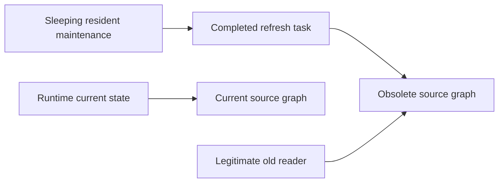

# Ownership boundary and source trace

Source: final49e616bc4d5c4a6d49354eea1f2d015b7a1622b4, application modules byte-identical to0a4, with the same complete production refresh function measured on509. This is source inspection plus fixture proof, not a current serving-process residency inventory.

| Owner | Intended lifecycle | Finding |
|---|---|---|
| Runtime manager entry and current state/context | Warm until existing ownership-aware eviction/close | Intentional; unchanged |
| Active request / old brain context | Until the legitimate reader releases it | Intentional; preserved and tested |
| Active hydration/FOIS/refresh writer | Until terminal completion and cleanup | Intentional; repeated cancellation now drains writer safely |
| Persistent cache/publication | Existing compatible recovery contract | Unchanged; no files cleared or evidence discarded |
| Completed refresh task retained by sleeping maintenance local | No consumer of its obsolete result after terminal processing | Avoidable; `finally: del worker` removes this root |
| Allocator pages after object release | Runtime/allocator dependent | Separate from object reachability; no assumed admission credit |

`dtos_app._refresh_resident_league` returns `_hydrate_league_runtime(...,prepare_history=False)`. The existing hydration path returns the prepared data dictionary. `services.league_maintenance.ensure_periodic_refresh` shields that worker, handles terminal success/failure, then sleeps before the next iteration. Previously its local completed task remained reachable during that sleep, including its result or exception traceback. A later legitimate publication could supersede the current state while this task still pinned the old graph.

`src/core/league_runtime/manager.py` reserves request ownership before hydration, tracks active requests and pins, selects only existing eligible idle contexts when its warm bound requires eviction, and closes writers before clearing contexts. These policies are not changed. No equivalent eligible current production runtime has been established, and no pre-entry eviction is added.

The correction removes the maintenance-to-completed-task edge after terminal handling. It does not remove the runtime/current edge or the reader/old edge. Old data becomes collectible only when its remaining legitimate owners are gone. Matched file counters are identical; the measured settled difference is anonymous/application memory. Neither collection nor allocator return is silently treated as free container capacity: the unchanged admission guard reads fresh actual telemetry.

Verified final-source controls exercise successful and failed refresh, incompatible restoration preserving current data, active-reader preservation, repeated publication, real pending writer cancellation, unsafe pressure deferral, protected FOIS standing reserve and one completed cold restoration after explicit fixture-pressure relief. No production cache, live request pins or worker ownership are inferred from a separate Shell process.

The same source trace found another owner in dtos_app.refresh_global_evidence: local data referenced the full default league through a six-hour delay, although ingestion receives only scalar season and a global file path. This task is separately owned by startup maintenance and need not appear in runtime.background_tasks. It now drops data immediately after extracting season. Current STATE/current-reader roots remain; a failed publication therefore still retains last-valid evidence normally. Tests cover success, acquisition failure/defer, missing season, incomplete startup and old-reader release. The retained01:43log samples do not inspect stack locals or establish this owner's production byte contribution. Separate matched default/global controls provide actual bounded fixture measurements.
